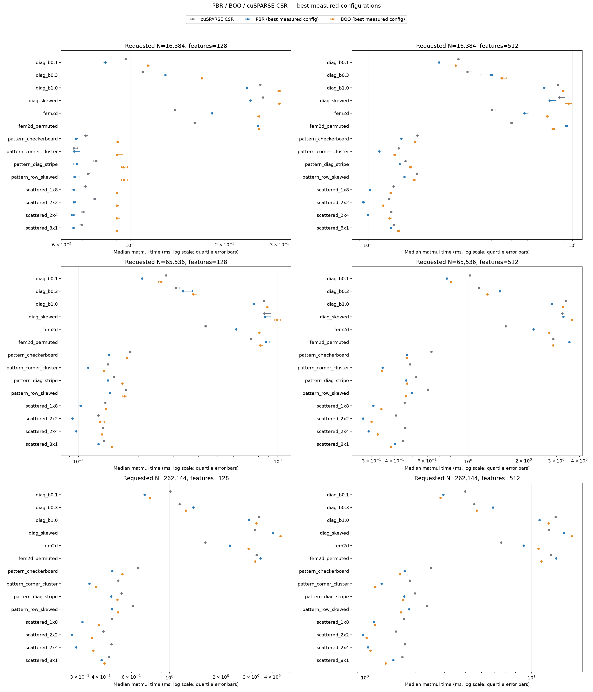

# PBR / BOO / cuSPARSE CSR results

Run status: **complete**. GPU: NVIDIA GeForce RTX 3090. [W&B run](https://wandb.ai/private-dayan/torch-fast-spdmm/runs/4nk9coe9).

Times are medians in milliseconds. PBR and BOO are the **best measured configuration** in each workload, selected retrospectively; all configurations remain in `summary.csv`.

| Profile | Requested N | Features | CSR ms | PBR ms | PBR config | BOO ms | BOO config |
|---|---:|---:|---:|---:|---|---:|---|
| diag_b0.1 | 16384 | 128 | 0.09626 | 0.08291 | pbr_b4_min8_sm2048 | 0.11338 | boo_hem_k64 |
| diag_b0.3 | 16384 | 128 | 0.10944 | 0.12902 | pbr_b4_min8_sm2048 | 0.16896 | boo_hem_k64 |
| diag_b1.0 | 16384 | 128 | 0.25989 | 0.23547 | pbr_b8_min12_sm2048 | 0.29798 | boo_hem_k32 |
| diag_skewed | 16384 | 128 | 0.26507 | 0.24166 | pbr_b8_min12_sm2048 | 0.29912 | boo_hem_k32 |
| fem2d | 16384 | 128 | 0.13859 | 0.18227 | pbr_b8_min8_sm2048 | 0.25754 | boo_hem_k32 |
| fem2d_permuted | 16384 | 128 | 0.16019 | 0.25594 | pbr_b8_min8_sm2048 | 0.25712 | boo_hem_k32 |
| pattern_checkerboard | 16384 | 128 | 0.07168 | 0.06662 | pbr_b8_min12_sm2048 | 0.09093 | boo_hem_k32 |
| pattern_corner_cluster | 16384 | 128 | 0.06554 | 0.06578 | pbr_b4_min4_sm2048 | 0.09011 | boo_hem_k32 |
| pattern_diag_stripe | 16384 | 128 | 0.07725 | 0.06707 | pbr_b8_min12_sm2048 | 0.09462 | boo_hem_k32 |
| pattern_row_skewed | 16384 | 128 | 0.07270 | 0.06603 | pbr_b4_min4_sm2048 | 0.09522 | boo_hem_k8 |
| scattered_1x8 | 16384 | 128 | 0.07157 | 0.06554 | pbr_b4_min4_sm2048 | 0.09011 | boo_hem_k32 |
| scattered_2x2 | 16384 | 128 | 0.07666 | 0.06554 | pbr_b8_min8_sm2048 | 0.09011 | boo_hem_k8 |
| scattered_2x4 | 16384 | 128 | 0.07046 | 0.06539 | pbr_b8_min12_sm2048 | 0.09013 | boo_hem_k32 |
| scattered_8x1 | 16384 | 128 | 0.06963 | 0.06552 | pbr_b8_min12_sm2048 | 0.09011 | boo_hem_k32 |
| diag_b0.1 | 16384 | 512 | 0.27546 | 0.22118 | pbr_b4_min8_sm2048 | 0.26707 | boo_hem_k64 |
| diag_b0.3 | 16384 | 512 | 0.30515 | 0.39680 | pbr_b4_min8_sm2048 | 0.44946 | boo_hem_k64 |
| diag_b1.0 | 16384 | 512 | 0.84864 | 0.72696 | pbr_b8_min8_sm2048 | 0.89958 | boo_hem_k32 |
| diag_skewed | 16384 | 512 | 0.86154 | 0.77170 | pbr_b8_min8_sm2048 | 0.95590 | boo_hem_k32 |
| fem2d | 16384 | 512 | 0.40141 | 0.58054 | pbr_b8_min12_sm2048 | 0.75104 | boo_hem_k16 |
| fem2d_permuted | 16384 | 512 | 0.50315 | 0.94003 | pbr_b8_min8_sm2048 | 0.80128 | boo_hem_k32 |
| pattern_checkerboard | 16384 | 512 | 0.17309 | 0.14438 | pbr_b2_min3_sm2048 | 0.16885 | boo_hem_k8 |
| pattern_corner_cluster | 16384 | 512 | 0.14029 | 0.11264 | pbr_b4_min4_sm2048 | 0.13403 | boo_hem_k8 |
| pattern_diag_stripe | 16384 | 512 | 0.15146 | 0.14182 | pbr_b8_min12_sm2048 | 0.16040 | boo_hem_k32 |
| pattern_row_skewed | 16384 | 512 | 0.17210 | 0.14949 | pbr_b8_min8_sm2048 | 0.16650 | boo_hem_k8 |
| scattered_1x8 | 16384 | 512 | 0.13210 | 0.10138 | pbr_b8_min8_sm2048 | 0.12800 | boo_hem_k8 |
| scattered_2x2 | 16384 | 512 | 0.12571 | 0.09413 | pbr_b8_min12_sm2048 | 0.11776 | boo_hem_k8 |
| scattered_2x4 | 16384 | 512 | 0.12898 | 0.09926 | pbr_b8_min12_sm2048 | 0.12638 | boo_hem_k8 |
| scattered_8x1 | 16384 | 512 | 0.13246 | 0.12846 | pbr_b8_min12_sm2048 | 0.14024 | boo_hem_k16 |
| diag_b0.1 | 65536 | 128 | 0.27443 | 0.20838 | pbr_b4_min8_sm2048 | 0.26010 | boo_hem_k64 |
| diag_b0.3 | 65536 | 128 | 0.30757 | 0.33498 | pbr_b4_min8_sm2048 | 0.37619 | boo_hem_k64 |
| diag_b1.0 | 65536 | 128 | 0.85299 | 0.75672 | pbr_b8_min12_sm2048 | 0.88714 | boo_hem_k64 |
| diag_skewed | 65536 | 128 | 0.85760 | 0.86477 | pbr_b8_min8_sm2048 | 0.99067 | boo_hem_k32 |
| fem2d | 65536 | 128 | 0.43483 | 0.61941 | pbr_b8_min12_sm2048 | 0.80797 | boo_hem_k32 |
| fem2d_permuted | 65536 | 128 | 0.73443 | 0.87091 | pbr_b8_min8_sm2048 | 0.81613 | boo_hem_k32 |
| pattern_checkerboard | 65536 | 128 | 0.18125 | 0.14234 | pbr_b2_min3_sm2048 | 0.17446 | boo_hem_k32 |
| pattern_corner_cluster | 65536 | 128 | 0.14030 | 0.11162 | pbr_b4_min4_sm2048 | 0.13403 | boo_hem_k32 |
| pattern_diag_stripe | 65536 | 128 | 0.15053 | 0.14029 | pbr_b8_min12_sm2048 | 0.16589 | boo_hem_k16 |
| pattern_row_skewed | 65536 | 128 | 0.17306 | 0.14336 | pbr_b4_min8_sm2048 | 0.17046 | boo_hem_k32 |
| scattered_1x8 | 65536 | 128 | 0.13619 | 0.10240 | pbr_b8_min8_sm2048 | 0.13757 | boo_hem_k32 |
| scattered_2x2 | 65536 | 128 | 0.12587 | 0.09312 | pbr_b8_min12_sm2048 | 0.12800 | boo_hem_k32 |
| scattered_2x4 | 65536 | 128 | 0.13298 | 0.09728 | pbr_b8_min12_sm2048 | 0.13107 | boo_hem_k32 |
| scattered_8x1 | 65536 | 128 | 0.13411 | 0.12595 | pbr_b8_min12_sm2048 | 0.14678 | boo_hem_k32 |
| diag_b0.1 | 65536 | 512 | 1.02093 | 0.76539 | pbr_b4_min8_sm2048 | 0.80384 | boo_hem_k64 |
| diag_b0.3 | 65536 | 512 | 1.14688 | 1.48326 | pbr_b4_min8_sm2048 | 1.27078 | boo_hem_k64 |
| diag_b1.0 | 65536 | 512 | 3.36733 | 2.83235 | pbr_b8_min12_sm2048 | 3.25733 | boo_hem_k64 |
| diag_skewed | 65536 | 512 | 3.23686 | 3.27379 | pbr_b8_min12_sm2048 | 3.62803 | boo_hem_k64 |
| fem2d | 65536 | 512 | 1.59539 | 2.25792 | pbr_b8_min8_sm2048 | 2.74125 | boo_hem_k32 |
| fem2d_permuted | 65536 | 512 | 2.89178 | 3.52717 | pbr_b8_min2_sm2048 | 2.87738 | boo_hem_k32 |
| pattern_checkerboard | 65536 | 512 | 0.63222 | 0.46541 | pbr_b2_min3_sm2048 | 0.46694 | boo_hem_k32 |
| pattern_corner_cluster | 65536 | 512 | 0.48424 | 0.34408 | pbr_b4_min4_sm2048 | 0.34202 | boo_hem_k32 |
| pattern_diag_stripe | 65536 | 512 | 0.52216 | 0.46029 | pbr_b8_min12_sm2048 | 0.46694 | boo_hem_k32 |
| pattern_row_skewed | 65536 | 512 | 0.60296 | 0.49347 | pbr_b8_min8_sm2048 | 0.45920 | boo_hem_k64 |
| scattered_1x8 | 65536 | 512 | 0.45261 | 0.30678 | pbr_b8_min8_sm2048 | 0.33883 | boo_hem_k16 |
| scattered_2x2 | 65536 | 512 | 0.40653 | 0.26931 | pbr_b8_min12_sm2048 | 0.29910 | boo_hem_k32 |
| scattered_2x4 | 65536 | 512 | 0.45654 | 0.28877 | pbr_b8_min12_sm2048 | 0.32338 | boo_hem_k32 |
| scattered_8x1 | 65536 | 512 | 0.44274 | 0.40243 | pbr_b8_min12_sm2048 | 0.38093 | boo_hem_k32 |
| diag_b0.1 | 262144 | 128 | 1.01274 | 0.71578 | pbr_b4_min8_sm2048 | 0.76909 | boo_hem_k64 |
| diag_b0.3 | 262144 | 128 | 1.14586 | 1.38069 | pbr_b4_min8_sm2048 | 1.24406 | boo_hem_k64 |
| diag_b1.0 | 262144 | 128 | 3.33202 | 2.91368 | pbr_b8_min12_sm2048 | 3.21946 | boo_hem_k64 |
| diag_skewed | 262144 | 128 | 3.14662 | 4.00998 | pbr_b8_min12_sm2048 | 4.44365 | boo_hem_k32 |
| fem2d | 262144 | 128 | 1.61829 | 2.25216 | pbr_b8_min8_sm2048 | 2.89637 | boo_hem_k32 |
| fem2d_permuted | 262144 | 128 | 3.22355 | 3.40275 | pbr_b8_min12_sm2048 | 3.16502 | boo_hem_k32 |
| pattern_checkerboard | 262144 | 128 | 0.65638 | 0.46387 | pbr_b2_min3_sm2048 | 0.53146 | boo_hem_k32 |
| pattern_corner_cluster | 262144 | 128 | 0.50227 | 0.34099 | pbr_b8_min12_sm2048 | 0.37274 | boo_hem_k32 |
| pattern_diag_stripe | 262144 | 128 | 0.52531 | 0.45722 | pbr_b8_min12_sm2048 | 0.49766 | boo_hem_k32 |
| pattern_row_skewed | 262144 | 128 | 0.61235 | 0.46285 | pbr_b4_min8_sm2048 | 0.50157 | boo_hem_k32 |
| scattered_1x8 | 262144 | 128 | 0.46080 | 0.31027 | pbr_b8_min8_sm2048 | 0.38605 | boo_hem_k32 |
| scattered_2x2 | 262144 | 128 | 0.41168 | 0.26910 | pbr_b8_min8_sm2048 | 0.35219 | boo_hem_k32 |
| scattered_2x4 | 262144 | 128 | 0.45814 | 0.28570 | pbr_b8_min12_sm2048 | 0.35938 | boo_hem_k32 |
| scattered_8x1 | 262144 | 128 | 0.44550 | 0.40141 | pbr_b8_min12_sm2048 | 0.41779 | boo_hem_k64 |
| diag_b0.1 | 262144 | 512 | 3.98986 | 2.95024 | pbr_b4_min8_sm2048 | 2.83534 | boo_hem_k64 |
| diag_b0.3 | 262144 | 512 | 4.51970 | 5.86699 | pbr_b4_min8_sm2048 | 4.67904 | boo_hem_k64 |
| diag_b1.0 | 262144 | 512 | 13.90541 | 11.13749 | pbr_b8_min8_sm2048 | 12.63104 | boo_hem_k64 |
| diag_skewed | 262144 | 512 | 12.65341 | 15.68398 | pbr_b8_min8_sm2048 | 17.39418 | boo_hem_k32 |
| fem2d | 262144 | 512 | 6.57035 | 8.96496 | pbr_b8_min12_sm2048 | 10.97933 | boo_hem_k32 |
| fem2d_permuted | 262144 | 512 | 13.07902 | 14.04306 | pbr_b8_min8_sm2048 | 11.42059 | boo_hem_k32 |
| pattern_checkerboard | 262144 | 512 | 2.48675 | 1.72954 | pbr_b2_min3_sm2048 | 1.62701 | boo_hem_k32 |
| pattern_corner_cluster | 262144 | 512 | 1.85958 | 1.25798 | pbr_b8_min8_sm2048 | 1.15251 | boo_hem_k32 |
| pattern_diag_stripe | 262144 | 512 | 1.99698 | 1.72042 | pbr_b2_min3_sm2048 | 1.69003 | boo_hem_k32 |
| pattern_row_skewed | 262144 | 512 | 2.35256 | 1.84262 | pbr_b8_min8_sm2048 | 1.64403 | boo_hem_k64 |
| scattered_1x8 | 262144 | 512 | 1.71464 | 1.13056 | pbr_b8_min8_sm2048 | 1.14621 | boo_hem_k32 |
| scattered_2x2 | 262144 | 512 | 1.53446 | 0.97173 | pbr_b8_min12_sm2048 | 1.02190 | boo_hem_k32 |
| scattered_2x4 | 262144 | 512 | 1.73619 | 1.04346 | pbr_b8_min12_sm2048 | 1.07914 | boo_hem_k32 |
| scattered_8x1 | 262144 | 512 | 1.67936 | 1.48224 | pbr_b8_min12_sm2048 | 1.33427 | boo_hem_k64 |
