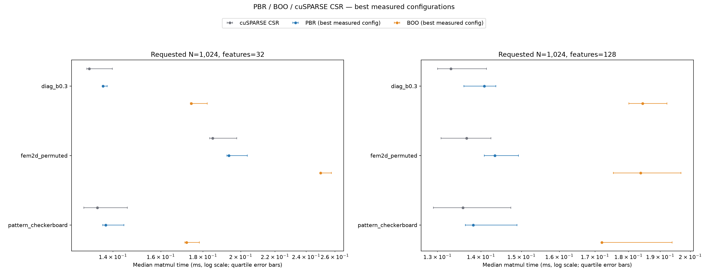

# PBR / BOO / cuSPARSE CSR results

Run status: **complete**. GPU: NVIDIA GeForce RTX 3090. [W&B run](https://wandb.ai/private-dayan/torch-fast-spdmm/runs/6tmocdmr).

Times are medians in milliseconds. PBR and BOO are the **best measured configuration** in each workload, selected retrospectively; all configurations remain in `summary.csv`.

| Profile | Requested N | Features | CSR ms | PBR ms | PBR config | BOO ms | BOO config |
|---|---:|---:|---:|---:|---|---:|---|
| diag_b0.3 | 1024 | 32 | 0.13107 | 0.13619 | pbr_b8_min8_sm2048 | 0.17421 | boo_hem_k64 |
| fem2d_permuted | 1024 | 32 | 0.18491 | 0.19354 | pbr_b4_min2_sm2048 | 0.24989 | boo_hem_k32 |
| pattern_checkerboard | 1024 | 32 | 0.13410 | 0.13723 | pbr_b8_min8_sm2048 | 0.17203 | boo_hem_k32 |
| diag_b0.3 | 1024 | 128 | 0.13299 | 0.14080 | pbr_b8_min8_sm2048 | 0.18442 | boo_hem_k16 |
| fem2d_permuted | 1024 | 128 | 0.13664 | 0.14336 | pbr_b4_min8_sm2048 | 0.18376 | boo_hem_k8 |
| pattern_checkerboard | 1024 | 128 | 0.13574 | 0.13816 | pbr_b8_min8_sm2048 | 0.17203 | boo_hem_k8 |
